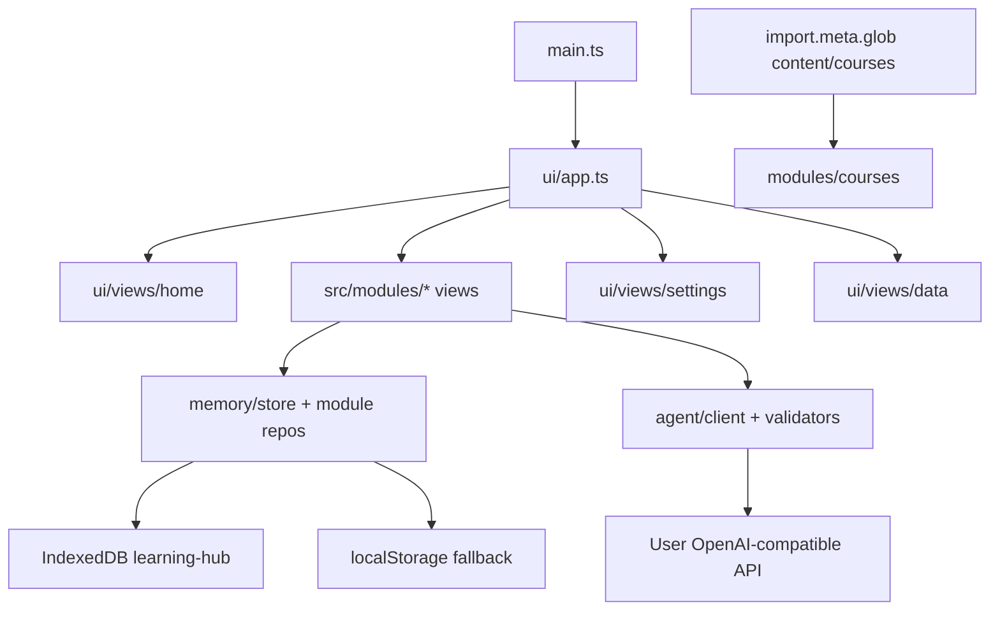

# Learning Hub: Implementation Plan

Status: **P0 tooling is done** — [`.cursor/`](.cursor/) (rules, agents, commands, hooks), [`content/courses/`](content/courses/) (discrete-math + learning-science + drills/plan), [`docs/private/BRIEF.md`](docs/private/BRIEF.md), [`docs/source/read-handwritten-mind-maps.SKILL.md`](docs/source/read-handwritten-mind-maps.SKILL.md). **No `src/`, `package.json`, or CI yet.** Phase 1 bootstraps the app by copying and adapting `/workspace/discrete-tasks` (read-only). This document is saved verbatim as [`PLAN.md`](PLAN.md); phase 1 also writes [`AGENTS.md`](AGENTS.md) per brief §0.

---

## 1. Goal and user

- **Goal:** A static, installable, offline-first PWA that supports Vladislav’s learning system: hand-drawn mind maps (Goodnotes), course organization, mistake logging with spaced re-check, Anki deck generation, Feynman probing (no lecturing), daily interleaving, and a voice/research window. All study data stays on-device; LLM features use a user-supplied OpenAI-compatible API key with clipboard + Grok Bot fallbacks.
- **User:** Vladislav, 18, university student, autism + ADHD, 2e. Learns via mind maps and interleaving; prefers minimalism. **UI: simple literal English.** **AI feedback language:** Settings (`feedbackLanguage`, default **Russian**). Calm dark UI; one task in focus; no pressure timers or alarm red.

---

## 2. Architecture and module map

### Stack (match discrete-tasks)

- **Vite 8 + vanilla strict TypeScript** (no UI framework). Runtime deps: `katex`, `workbox-window`; add `mermaid` (lazy), `sql.js` + bundled `sql-wasm.wasm`, `jszip` (Anki `.apkg`).
- **Tooling:** `vite-plugin-pwa` (`registerType: 'prompt'`, `injectRegister: false` like discrete-tasks), `vitest`, `happy-dom`, `fake-indexeddb`, `eslint` + `typescript-eslint`, `prettier`, `tsx`, `@playwright/test`. Node ≥ 20.19.
- **Routing:** hash routes (`#/`, `#/mindmap`, `#/courses`, … `#/settings`, `#/data`). Default `#/`.
- **Base path:** `base: '/learning-hub/'` in [`vite.config.ts`](vite.config.ts). All URLs via `import.meta.env.BASE_URL`.
- **Bootstrap:** [`src/main.ts`](src/main.ts) — inject clock, storage adapters, fetch, mount [`src/ui/app.ts`](src/ui/app.ts).



### Files copied from discrete-tasks (brief §1) and how they change

| Source (discrete-tasks) | Destination (learning-hub) | Changes |
|---|---|---|
| `src/lib/guards.ts`, `result.ts`, `time.ts`, `dom.ts` + `*.test.ts` | Same paths | Keep; rename nothing. |
| `src/lib/markdown.ts`, `math.ts` + tests | Same | Keep for course text + KaTeX in modules. |
| `src/lib/ids.ts`, `random.ts` + tests | Same | Keep for IDs and interleave seeding. |
| `src/lib/check/*`, `expr/*`, `rational.ts` | **Omit** | Not needed for Learning Hub. |
| `src/memory/storage/adapter.ts`, `indexeddb.ts`, `local.ts`, `fake.ts`, `storage.test.ts` | Same | `DB_NAME = 'learning-hub'`; **multi-store schema** (see §3); bump `DB_VERSION`. |
| `src/memory/srs.ts`, `srs.test.ts` | Same | Reuse SM-2 for mistake re-check cards; add thin wrapper `mistake-srs.ts` in `modules/mistakes/` if interval policy (+1/+3/+7 first reps) differs from problem cards. |
| `src/memory/picker.ts`, `picker.test.ts` | `src/memory/interleave-picker.ts` | Generalize `PickableProblem` → `InterleaveItem` (topic id, pool, priority); keep no-adjacent-same-topic + seeded RNG; **do not** import bank types. |
| `src/agent/errors.ts`, `extract-json.ts` + tests | Same | Keep. |
| `src/agent/client.ts`, `client.test.ts` | Same | Extend `ChatMessage.content` to `string \| ContentPart[]`; OpenRouter headers; `model` param override for vision calls (see §4). |
| `src/agent/settings.ts`, `settings.test.ts` | Same | `SETTINGS_KEY = 'lh:settings'`, `SETTINGS_VERSION = 1`; presets **nous \| openrouter \| custom** (drop groq); **textModel** + **visionModel**; **feedbackLanguage** (default `ru`); **grokBotUrl**; **glossary** `string[]` or `{term, meaning}[]`; remove `agentProblems`. |
| `src/ui/tokens.css`, `base.css`, `components.css` | Same | Rebrand copy only; add module tile + rail styles. |
| `src/ui/components/top-bar.ts`, `update-prompt.ts` + tests | Same | Top bar: Home title + Settings + Data links; drop practice nav. |
| `src/ui/views/data.ts` | Adapt | Export **all module stores** (see §3), filename `learning-hub-YYYY-MM-DD.json`; reset clears module data, not settings. |
| `src/ui/views/settings.ts` | Heavy adapt | Two model fields, vision default for OpenRouter, glossary editor, Grok link, feedback language, Test connection (`GET /models`). |
| `vite.config.ts` | Copy + edit | `base: '/learning-hub/'`, manifest name **Learning Hub** / short **Hub**, CSP updates (§4), precache wasm, copy `sql-wasm.wasm` to `public/` or vite `assetsInclude`. |
| `public/icons/*`, icon generation | Copy + new mark | Dark tile, green/purple mark per brief. |
| `e2e/*`, `playwright.config.ts` | Copy + adapt | `baseURL` `/learning-hub/`; module screenshots (§7). |
| `.github/workflows/deploy.yml` | Copy | Unchanged job graph. |
| `eslint.config.js`, `tsconfig.json`, `.prettierrc.json`, `index.html`, `.env.example`, `.gitignore` | Copy + adapt | CSP comment in `index.html`; app title Learning Hub. |

**Not copied:** `src/bank/**`, `src/ui/views/practice*`, `progress*`, `scripts/verify/**`, discrete-tasks-specific agent `actions.ts` / `validate-generated.ts` (replaced by per-module validators).

### New / module layout

```
src/
  main.ts
  lib/                    # copied subset + image-downscale.ts, mermaid-loader.ts, speech.ts
  memory/
    schema.ts             # export envelope + version
    migrate.ts
    store.ts              # orchestrates multi-store load/save
    export.ts             # merge/replace import for full hub export
    interleave-picker.ts  # adapted from picker.ts
    srs.ts
    storage/
  agent/
    client.ts
    settings.ts
    errors.ts
    extract-json.ts
    grok-fallback.ts      # copy prompt + optional window.open
    prompts/
      mindmap-skill.md    # sections 3–5 from docs/source/…SKILL.md (verbatim)
      mindmap-critique.md # system wrapper: JSON-only, drill context
      voice-research.md
      voice-viz.md
      anki-cards.md
      feynman-check.md
    validators/
      mindmap-feedback.ts + .test.ts
      voice-research.ts + .test.ts
      anki-cards.ts + .test.ts
      feynman-round.ts + .test.ts
  modules/
    mindmap/              # (c) — core.ts, prompts.ts, image.ts, history.ts, view.ts
    courses/              # (b) — parse.ts, catalog.ts, progress.ts, view.ts
    mistakes/             # (a) — types.ts, queue.ts, stats.ts, view.ts
    anki/                 # (e) — generate.ts, table.ts, apkg.ts, csv.ts, view.ts
    feynman/              # (f) — session.ts, view.ts
    interleave/           # (g) — plan.ts, block-view.ts, view.ts
    voice/                # (d) — recognition.ts, structure.ts, mermaid-ui.ts, view.ts
  ui/
    app.ts                # router: home + 7 modules + settings + data
    runtime.ts            # deps bag (store, settings, client, clock)
    views/home.ts
    views/settings.ts     # may split from discrete-tasks if large
    views/data.ts
    components/           # rich-text.ts (from DT), module-shell.ts
content/courses/          # already in repo — bundled at build
scripts/
  sync-courses.ts         # copy /workspace/learning-system/courses → content/courses when present
  generate-icons.ts       # optional; or copy DT script
```

### Course content bundling

- **Build-time bundle:** `import.meta.glob('/content/courses/**/*.md', { query: '?raw', import: 'default', eager: true })` (path alias `@content` or relative from `src/modules/courses/catalog.ts`). Include `mindmapping-drills.md`, `interleaving-plan.md`, both course trees; **exclude** `*.csv` from glob (Anki CSVs are reference only unless imported manually).
- **Runtime:** [`src/modules/courses/parse.ts`](src/modules/courses/parse.ts) — tolerant parser: `# Course`, `## Module`, checkboxes, `###` lessons, optional YAML frontmatter (`topics:`, `goal:`).
- **Sync script:** [`scripts/sync-courses.ts`](scripts/sync-courses.ts) — `fs.cp` from `/workspace/learning-system/courses` → `content/courses` when source exists; no-op with exit 0 and log line if missing; run manually or in CI optional step (not required for build).
- **In-app import:** File picker `accept=".md,text/markdown"` merges into IndexedDB course overrides store (same slug = update body, preserve progress).

---

## 3. Data model

### IndexedDB `learning-hub`

- **DB version:** `1` (increment on migration only).
- **Pattern:** one object store per domain (brief: stores per module), plus `meta` for schema version and corrupt quarantine pointers — same reliability patterns as discrete-tasks [`store.ts`](https://github.com/xgrybvo6508-dot/discrete-tasks/blob/main/src/memory/store.ts) (debounced save, `visibilitychange`, quarantine on parse failure).

| Store name | Key | Value (summary) |
|---|---|---|
| `meta` | `'schema'` | `{ version: 1 }` |
| `mistakes` | `id` | Mistake record + embedded SM-2 card state |
| `courses` | `slug` | Parsed course snapshot + checklist progress |
| `courseSessions` | `id` | Session log rows |
| `mindmapHistory` | `id` | Drill run: prompt id, scores, duration, thumbnail blob ref |
| `mindmapBlobs` | `id` | Thumbnail JPEG ArrayBuffer (≤300px) |
| `ankiDecks` | `id` | Saved generated decks (cards array) |
| `feynmanSessions` | `id` | Rounds, gaps, status |
| `interleavePlans` | `dateKey` (YYYY-MM-DD local) | Daily plan + completion state |
| `voiceHistory` | `id` | Last 20 entries (transcript, mode, result summary) |

**localStorage fallback:** single JSON blob key `lh:memory-fallback` mirroring export shape if IDB unavailable (same adapter pattern as DT `local.ts`).

### Type sketches (`src/memory/schema.ts`)

- `HubMemoryV1`: `{ version: 1; createdAt; updatedAt; mistakes[]; courses[]; sessions[]; mindmap[]; ankiDecks[]; feynman[]; interleave: Record<dateKey, Plan>; voice[] }` — or load each store independently; export flattens to one JSON object.
- **Mistake:** `{ id, createdAt, updatedAt, wrong, cause: CauseCategory, fix, topic, courseSlug?, source?, card: CardState }`.
- **CauseCategory:** `concept-gap | misread | careless | wrong-method | memory-lapse | time-pressure`.
- **Course progress:** per-item id stable slug from heading path; `{ done: boolean }`.
- **Mindmap history:** `{ id, drillId, mode: 'topic'|'text', sourceText?, scores, strengths, issues, at, activeMs, thumbnailId }`.

### Migrations

- [`src/memory/migrate.ts`](src/memory/migrate.ts): `migrate(raw, now): Result<HubMemoryV1, MigrationError>`; v0 → empty; never drop unknown fields without quarantine copy in `meta` key `corrupt:…`.

### Export / import

- **Filename:** `learning-hub-YYYY-MM-DD.json` via `exportFileName(now)`.
- **Envelope:**
  ```ts
  { app: 'learning-hub', kind: 'hub-export', exportVersion: 1, memoryVersion: 1, exportedAt, data: HubMemoryV1 }
  ```
- **Excludes:** `lh:settings`, API key, any `localStorage` settings — same guarantee as DT [`export.ts`](https://github.com/xgrybvo6508-dot/discrete-tasks/blob/main/src/memory/export.ts).
- **Import modes:** merge (by id/slug, newer `updatedAt` wins) or replace all module stores; preview counts before apply; calm errors for wrong file / newer version / corrupt.
- **Unit tests:** export round-trip; import merge keeps course progress; exported JSON never contains `apiKey` or `sk-`.

### Settings `lh:settings` (version 1)

```ts
interface Settings {
  version: 1;
  preset: 'nous' | 'openrouter' | 'custom';
  baseUrl: string;
  textModel: string;
  visionModel: string;
  apiKey: string;
  feedbackLanguage: string;  // default 'ru'
  grokBotUrl: string;        // default ''
  glossary: Array<{ term: string; meaning: string }>;
}
```

- **Presets:** Nous Portal (`poolside/laguna-s-2.1:free` text default); OpenRouter (`https://openrouter.ai/api/v1`, default vision `google/gemma-4-31b-it:free`, alt documented in UI copy); Custom (https only except localhost).
- **Glossary:** edited in Settings; appended to mindmap prompts (user entries override legend conflicts).

---

## 4. LLM layer

### Client ([`src/agent/client.ts`](src/agent/client.ts))

- **Content parts:**
  ```ts
  type ContentPart =
    | { type: 'text'; text: string }
    | { type: 'image_url'; image_url: { url: string } }; // data:image/jpeg;base64,...
  ```
- **API:** `complete(settings, { messages, temperature, maxTokens, timeoutMs, jsonMode?, model? })` — `model` defaults to `settings.textModel`; mindmap pass `settings.visionModel`.
- **OpenRouter:** when `preset === 'openrouter'`, add headers `HTTP-Referer: https://xgrybvo6508-dot.github.io/learning-hub/` and `X-Title: Learning Hub` (no secrets).
- **JSON mode:** request `response_format: { type: 'json_object' }`; on 400 with `response_format` in body, retry once without it (per DT); validate with module validator; **one** retry on invalid JSON at action layer.
- **Errors:** `AgentError` kinds → calm `userMessage` (network/CORS, 401/403, 404, 429, timeout, bad-response, config) per [`.cursor/rules/40-security-secrets.mdc`](.cursor/rules/40-security-secrets.mdc).

### CSP ([`vite.config.ts`](vite.config.ts))

Start from discrete-tasks CSP; **add:**

- `img-src 'self' data: blob:` — canvas thumbnails and image preview.
- `script-src 'self' 'wasm-unsafe-eval'` — sql.js (comment in config).
- **Mermaid:** after offline test, if needed: `style-src 'unsafe-inline'` for Mermaid-injected SVG styles (comment why); keep `default-src 'self'`.
- Precache: include `**/*.wasm`, KaTeX fonts, mermaid chunks.

### No-key fallback ([`src/agent/grok-fallback.ts`](src/agent/grok-fallback.ts))

- Button label: **Copy prompt + open Grok Bot**.
- `navigator.clipboard.writeText(fullPrompt)`; if `grokBotUrl` set, `window.open(url)`; else toast: *Prompt copied. Paste it into Grok Bot with your photo.*
- Used on: mindmap analyze, voice structure, anki generate, feynman round (when configured).

---

## 5. Modules: screens, data, contracts, acceptance tests

### (c) Mindmapping trainer — `src/modules/mindmap/`

**Screens (hash `#/mindmap`):**

1. **Pick drill** — list from bundled `mindmapping-drills.md` (+ course module drills); modes Topic / Text; built-in fallback ~10 drills if parse empty.
2. **Timer** — 5/10/15 presets; quiet SVG ring; soft cue at end (Web Audio or short vibration if available); overrun allowed; no red.
3. **Capture** — file input, paste, drag-drop; preview; optional **detail mode** (2×2 tiles + overview per skill §0).
4. **Feedback** — purple panel: read summary, scores 0–10, strengths (≤3), issues (≤5), missing, next drill; unreadable list from `read.unreadable`.
5. **History** — list + SVG sparklines per criterion; thumbnail; **Redo this drill**.

**Prompts:**

- System: `mindmap-skill.md` (legend §3, drawings/math §4, accuracy §5) + `mindmap-critique.md` + drill text + glossary + `feedbackLanguage`.
- User: mode, topic/text, images as `ContentPart[]`.

**JSON contract** (`validators/mindmap-feedback.ts`):

```ts
{
  read: { core: string; clusters: { name: string; nodes: string[] }[]; relations: { from: string; to: string; label: string | null }[]; unreadable: string[] };
  scores: { structure, chunking, relations, coverage, overall: number }; // 0–10 each
  strengths: string[];  // max 3
  issues: { type: 'structure'|'grouping'|'relations'|'gap'|'missing'; detail: string }[]; // max 5
  missing: string[];    // max 5
  nextDrill: string;
}
```

**AC → tests:**

| AC | Unit | E2E |
|---|---|---|
| Prompt includes legend, accuracy rules, glossary | `prompts.test.ts` asserts substrings | — |
| Validator: fenced JSON, bounds, caps | `mindmap-feedback.test.ts` | — |
| Image downscale ≤2048 JPEG | `image.test.ts` with canvas fixture | — |
| Feedback UI + history point | — | `e2e/mindmap.spec.ts` mocked `fetch` |
| Real vision call | optional script `scripts/vision-smoke.ts` (manual, needs key) | — |

---

### (b) Course organizer — `src/modules/courses/`

**Screens (`#/courses`):** course list → module list (done/total) → module detail → **Next session** card → log session (minutes, note) → import `.md`.

**Data:** bundled catalog + `courses` store overrides; progress keyed by `courseSlug + itemId`.

**AC → tests:**

| AC | Unit | E2E |
|---|---|---|
| Re-import keeps progress by slug | `parse.test.ts` + `progress.test.ts` | import fixture md |
| Malformed file calm error | `parse.test.ts` throws typed error | file picker bad md |
| Progress in export | `export.test.ts` | export download contains course progress |

---

### (a) Mistakes review — `src/modules/mistakes/`

**Screens (`#/mistakes`):** list + filters (topic, cause) → create/edit form → stats strip (counts per cause) → **Re-check queue** (due only) → attempt with fix hidden → Got it / Partly / Missed.

**Data:** `mistakes` store; SM-2 on card; initial intervals +1, +3, +7 days for first successes (configure in `queue.ts` using `srs.reviewCard` + custom quality mapping).

**AC → tests:**

| AC | Unit | E2E |
|---|---|---|
| CRUD persists | `store.test.ts` fake IDB | reload after save |
| Queue due only | `queue.test.ts` fake clock | — |
| Outcome updates next due | `queue.test.ts` | — |
| Filter + stats | `stats.test.ts` | — |
| Feeds interleave pool | `interleave/plan.test.ts` includes due mistakes | — |

---

### (e) Anki deck generator — `src/modules/anki/`

**Screens (`#/anki`):** input topic / paste / pick course module → **Generate** → editable table (reorder, edit, delete, add) → KaTeX preview → Export `.apkg` / CSV → save locally.

**JSON:** `{ cards: { front, back, type: 'why'|'how'|'contrast'|'link', tags: string[] }[] }` (8–15 cards).

**AC → tests:**

| AC | Unit | E2E |
|---|---|---|
| Validator types + count bounds | `anki-cards.test.ts` | — |
| `.apkg` structure | `apkg.test.ts` unzip, sqlite note count, deck name, fields | — |
| CSV UTF-8 BOM + Cyrillic + LaTeX | `csv.test.ts` | — |

---

### (f) Feynman-check — `src/modules/feynman/`

**Screens (`#/feynman`):** audience selector → explain (textarea + optional mic from shared speech helper) → purple gap panel → answer 3 questions → up to 3 rounds → solid/open summary → **Explain this gap** (only then allow teaching) → log gap to mistakes.

**JSON round:** `{ gaps[], wrongAnalogies[], missingLinks[], jargonUnexplained[], questions[3] }` — **exactly 3** questions.

**AC → tests:**

| AC | Unit | E2E |
|---|---|---|
| System prompt forbids lecturing | `feynman-check.md` snapshot / `prompts.test.ts` | — |
| Validator rejects ≠3 questions | `feynman-round.test.ts` | — |
| One round mocked | — | `e2e/feynman.spec.ts` |

---

### (g) Interleaving scheduler — `src/modules/interleave/`

**Screens (`#/interleave`):** pick block length 15/20/25 and 2–4 blocks → generated plan → one item at a time + **why this now** → Done/Skip → break screen → Swap / Too much today.

**Logic:** `plan.ts` pulls due mistakes, next course session, mindmap drill id, anki/feynman placeholders; `interleave-picker.ts` orders items (no adjacent same topic; due mistakes first; seed = `dateKey`).

**AC → tests:**

| AC | Unit | E2E |
|---|---|---|
| No adjacent same topic | `interleave-picker.test.ts` | — |
| Due mistakes first | `plan.test.ts` | — |
| Empty pools handled | `plan.test.ts` | — |
| Plan persists per day | `plan.test.ts` fake clock | regenerate next day |

---

### (d) Voice window — `src/modules/voice/`

**Screens (`#/voice`):** full-screen; mic ≥120px; lang ru-RU/en-US; editable transcript; Research / Visualization toggle; **Structure it** → markdown or Mermaid; Copy, Share, Send to LLM, Grok fallback; history 20.

**JSON Research:** `{ question, why, context, subQuestions: string[3-6], sourcesWanted, outputFormat }`.

**Visualization:** markdown + fenced mermaid; parse with lazy `mermaid.run`; **Fix diagram** retry on error.

**AC → tests:**

| AC | Unit | E2E |
|---|---|---|
| Typing-only path | — | no mic permission |
| Mermaid offline | `mermaid-loader.test.ts` | render sample diagram |
| Invalid Mermaid shows error, not blank | `mermaid-ui.test.ts` | — |
| Speech fallback message | `recognition.test.ts` mock unsupported | — |

---

## 6. UI/UX

- **Home (`#/`)**: seven tiles — Mind map, Courses, Mistakes, Anki, Feynman, Interleave, Voice — plus header links **Settings** and **Data**. One column on phone; **iPad landscape:** optional slim left rail with same destinations (hidden on module focus screens).
- **Module shell:** top bar back to Home; single primary green button; AI content in `.panel--agent` (purple border/background soft).
- **Tokens:** exact values from brief §1 / [`30-design-system.mdc`](.cursor/rules/30-design-system.mdc) in [`src/ui/tokens.css`](src/ui/tokens.css).
- **Settings:** preset cards, base URL, text + vision models, key field + mask + Clear key, Test connection, feedback language select, Grok URL, glossary textarea (one term per line `term = meaning`).
- **Data:** export/import/reset copy from DT; label **Export data** / **Import data**; reset confirms typed phrase or second button.
- **iPad:** safe-area padding; inputs 16px+; touch 44px; no sidebar on timer/upload/solve views.

---

## 7. Testing, screenshots, deploy

### Vitest

- Colocated `*.test.ts` per §5 tables + storage migrations + agent client mocks.
- Run: `npm run typecheck && npm run lint && npm test && npm run build` before every phase Done.

### E2E (Playwright)

- `e2e/smoke.spec.ts` — home loads, navigate Settings/Data, export JSON shape.
- `e2e/offline.spec.ts` — SW scope `/learning-hub/`, offline reload home.
- Per-module specs as in §5; `webServer: vite preview` with `base`.

### Screenshots (brief §6)

- Script or spec: `e2e/screenshots.spec.ts` — every screen (home, a–g, Settings, Data) at **1024×1366** and **820×1180** portrait + both landscapes, `deviceScaleFactor: 2`, `hasTouch: true` → `screenshots/`.
- Plus **390×844** phone pass.
- **ui-designer** reviews shots for overflow and tap targets; fix and re-shoot in P9.

### Deploy (brief §5)

- Repo: `xgrybvo6508-dot/learning-hub`, public, `base: '/learning-hub/'`.
- Workflow: [`.github/workflows/deploy.yml`](.github/workflows/deploy.yml) — `npm ci` → `npm test` → `npm run build` → Pages artifact.
- Pre-ship: `/ship` checklist; `bash .cursor/hooks/secret-scan.sh < /dev/null` → `{}`; no `.env*` except `.env.example`.
- Live: `https://xgrybvo6508-dot.github.io/learning-hub/`.

---

## 8. Build phases (strict order)

| Phase | Scope | Key files | Sub-agents | Command | Definition of Done |
|---|---|---|---|---|---|
| **P0** | Tooling | `.cursor/*`, `content/courses`, docs | — | — | Hooks test pass; **done** |
| **P1** | Core scaffold | Copy DT toolchain; `src/lib`, `memory/storage`, `agent` base, `ui` CSS + `app.ts` + `home.ts`, `settings.ts`, `data.ts`, `vite.config.ts`, `index.html`, `package.json`, `AGENTS.md`, `scripts/sync-courses.ts` | **tester**, **ui-designer** | `/review` light | typecheck/lint/test/build green; home + settings + data export empty envelope; tester PASS |
| **P2** | **(c) Mindmap trainer** | `modules/mindmap/*`, `prompts/mindmap-*.md`, validators, `image.ts`, e2e mindmap | **prompt-author**, **pedagogy-reviewer**, **ui-designer**, **tester** | `/module mindmap` then `/review` | All (c) AC tests PASS; pedagogy table PASS |
| **P2b Deploy** | First Pages ship | `.github/workflows`, icons, push main | **tester** | `/ship` | `/ship` all green; site loads |
| **P3** | **(b) Courses** | `modules/courses/*`, glob bundle, parse/progress | **tester**, **pedagogy-reviewer** | `/module courses` | (b) AC PASS |
| **P4** | **(a) Mistakes** | `modules/mistakes/*`, SRS queue | **tester**, **pedagogy-reviewer** | `/module mistakes` | (a) AC PASS |
| **P5** | **(e) Anki** | `modules/anki/*`, sql.js wasm | **prompt-author**, **tester** | `/module anki` | (e) AC PASS; apkg verified on box |
| **P6** | **(f) Feynman** | `modules/feynman/*` | **prompt-author**, **pedagogy-reviewer**, **tester** | `/module feynman` | (f) AC PASS |
| **P7** | **(g) Interleave** | `modules/interleave/*`, `interleave-picker.ts` | **tester**, **pedagogy-reviewer** | `/module interleave` | (g) AC PASS |
| **P8** | **(d) Voice** | `modules/voice/*`, mermaid lazy | **prompt-author**, **ui-designer**, **tester** | `/module voice` | (d) AC PASS |
| **P9** | iPad polish | `e2e/screenshots.spec.ts`, CSS fixes | **ui-designer**, **tester** | `/review` | screenshots complete; no overflow |

Each implementation phase ends with **tester** run and, for modules, **pedagogy-reviewer** PASS/FAIL table.

---

## 9. Risks and mitigations

| Risk | Mitigation |
|---|---|
| **iOS Web Speech in standalone PWA** | Feature-detect; on failure show keyboard mic hint; transcript always editable; no hard dependency on mic. |
| **Goodnotes paste** | Listen `paste` on capture zone; document file export path; accept `image/*` file picker. |
| **Mermaid CSP** | Test built bundle; allow minimal `style-src 'unsafe-inline'` only if required; sandbox render container. |
| **sql.js wasm CSP** | `'wasm-unsafe-eval'` on `script-src`; serve wasm from same origin; precache in SW. |
| **Vision model availability** | Default OpenRouter free models; Test connection lists models; Grok fallback always available; document re-check of model IDs at build. |
| **Large course bundle** | Eager `?raw` glob acceptable for ~20 md files; monitor build size. |
| **IndexedDB thumbnails** | Store small JPEGs only; optional prune oldest history in Settings later (not v1). |

---

## Delivery report (post P9)

Per brief §7: live URL, per-module PASS/FAIL, key-dependent features, test counts, CSP notes, iOS issues, `screenshots/` paths, brief deviations — produced after P2b and updated at final ship.


