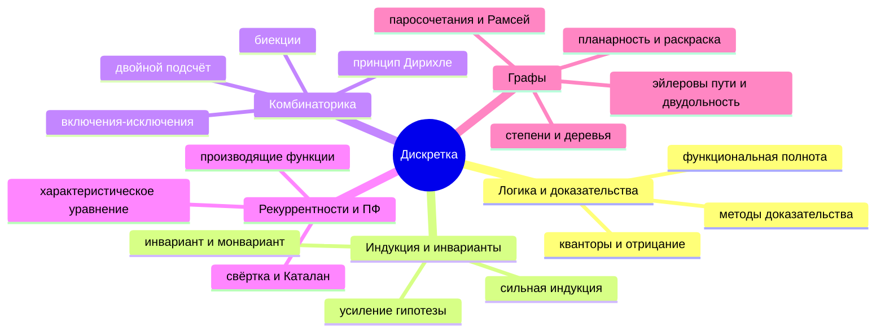

# Дискретная математика (Vlad) — обзор

> [!abstract] Формат: «я + ИИ», не ИИ-репетитор
> Ты решаешь и строишь структуру сам. ИИ — спарринг-партнёр: проверяет, задаёт неудобные вопросы, генерирует *варианты* задач, читает твои карты. Он **не** решает за тебя первым.

## Каркас курса (карта-скелет)

## Кластеры и связи (не список, а сеть)

- **Ядро = «как доказывать»** → [[01-logic-proofs]] ⇄ [[02-induction-invariants]]
  - логика *даёт язык* (кванторы, отрицание) → индукция *даёт двигатель* для $\forall n$
  - «от противного» ↔ «минимальный контрпример» (вполне упорядоченность) — *одна идея в двух костюмах*
- **Подсчёт** = [[03-combinatorics]] ⇄ [[04-recurrences-gf]]
  - комбинаторика *ставит* задачу «сколько?» → рекуррентность *разбивает* её по первому/последнему шагу → ПФ *решает* рекуррентность алгеброй
  - биекция ⇄ тождество: $\binom{2n}{n}/(n+1)$ появляется и через **отражение путей** (м.3), и через **$C(x)=1+xC(x)^2$** (м.4) — *контраст двух методов на одном объекте*
- **Структуры** = [[05-graphs]]
  - лемма о рукопожатиях = **двойной подсчёт** (м.3) на графе
  - $R(3,3)=6$ = **принцип Дирихле** (м.3) + перебор случаев (м.1)
  - деревья / турниры = **индукция** (м.2) через удаление листа/вершины
  - раскраска досок (м.2) = **раскраска графа**-сетки → инвариант
- **Сквозная ось «невозможность»**: функциональная неполнота (м.1) → раскраски/инварианты (м.2) → чётность степеней в Эйлере (м.5) → $E\le3V-6$ (м.5). *Каждый раз: найти величину, которую разрешённые операции не меняют.*

## Цели (проверяемые)
1. По форме утверждения за 30 секунд выбрать метод доказательства и записать скелет.
2. Решать задачи «сколько?» тремя путями (прямой счёт, биекция, рекуррентность/ПФ) и **сравнивать** их.
3. Решать линейные рекуррентности с постоянными коэффициентами (вкл. кратные корни и резонанс) и получать формулу через ПФ.
4. Узнавать в графовой задаче скрытую комбинаторику/индукцию/инвариант.
5. К концу 2 недель: решить 60–70% задач модулей без подсказок, а каждую ошибку превратить в Anki-карточку «почему/контраст».

## Как проходить модуль (сессия 45–90 мин)

| Блок | Время | Что делаешь | Зачем |
|---|---|---|---|
| Разогрев | 5 мин | Смотришь этот скелет + 5 Anki-карт | priming: деталям есть куда «прицепиться» |
| Попытка | 15–20 мин | 1–2 трудные задачи **до** чтения «Ключевых идей» | productive failure: попытка → объяснение лучше переносится |
| Карта | 15–20 мин | Майндмэп-дрилл модуля от руки в Goodnotes | кодирование через группы и связи |
| Перерыв | 5 мин | встать, вода, без телефона | сброс нагрузки |
| Задачи | 15–25 мин | ещё 2–3 задачи, *перемешав* с задачей из прошлого модуля | interleaving |
| Фейнман | 10 мин | голосом объяснить ИИ (промпт в модуле) | поиск пробелов |
| Закрытие | 5 мин | 1 инсайт → Obsidian, 2–3 новые карточки | закрепление |

На 45 минут: Разогрев + Попытка + Карта + Закрытие. Решения смотреть **только** после честной попытки (≥10 мин на задачу) — callout `Решение` свёрнут специально.

## Модули
1. [[01-logic-proofs|01 — Логика и доказательства]]
2. [[02-induction-invariants|02 — Индукция и инварианты]]
3. [[03-combinatorics|03 — Комбинаторика]]
4. [[04-recurrences-gf|04 — Рекуррентности и производящие функции]]
5. [[05-graphs|05 — Графы]]

Связанное: [[interleaving-plan]] · [[mindmapping-drills]] · [[learning-science/00-overview|Learning Science — обзор]] · Anki: `anki/discrete-math.apkg`

## Ресурсы (бесплатные, англ.)
- MIT 6.042J *Mathematics for Computer Science* (Lehman, Leighton, Meyer) — основной учебник: https://ocw.mit.edu/courses/6-042j-mathematics-for-computer-science-fall-2010/
- H. Wilf, *generatingfunctionology* (бесплатный PDF): https://www2.math.upenn.edu/~wilf/DownldGF.html
- Для задач олимпиадного уровня: A. Engel, *Problem-Solving Strategies* (главы Invariance, Pigeonhole, Induction).
