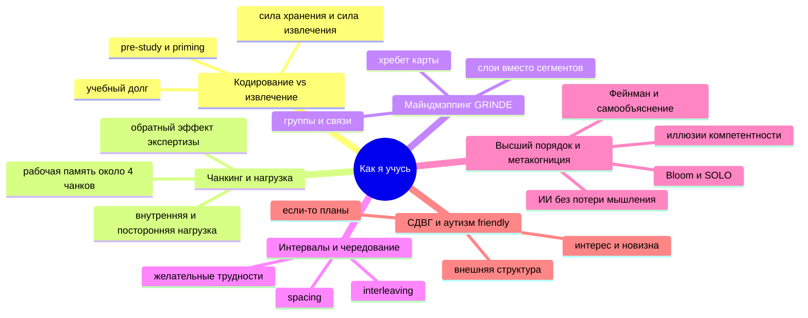

# Learning Science (Vlad) — обзор

> [!abstract] Зачем этот курс
> Это **мета-курс**: он делает быстрее все остальные (дискретка, нейропсихология, английский). Каждое понятие здесь сразу применяется к [[discrete-math/00-overview|Дискретке]] — так курс сам становится примером interleaving.

## Каркас курса

## Кластеры и связи

- **Двигатель памяти** = [[01-encoding-retrieval]] ⇄ [[04-spacing-interleaving]]
  - кодирование *строит* сеть → извлечение *укрепляет* доступ к ней → интервалы *делают извлечение трудным* ⇒ прочнее
  - контраст: извлечение не чинит плохую структуру (Sung: сначала SIR — spaced interleaved retrieval, потом качество кодирования)
- **Ограничение** = [[02-chunking-cognitive-load]]
  - рабочая память мала → чанкинг её обходит → майндмэп = *внешний чанкинг*
  - перегрузка ↔ «желательная трудность»: граница = можешь ли ты её преодолеть
- **Инструмент** = [[03-mindmapping-grinde]]
  - G (группы) = чанкинг (м.2) · R/I (связи) = высший порядок (м.5) · E (акцент) = оценивание по Блуму · перерисовка = извлечение (м.1)
- **Управление** = [[05-higher-order-metacognition]]
  - метакогниция *выбирает* стратегию → Фейнман *проверяет* понимание → ИИ *бросает вызов*, но не думает за тебя
- **Моя физиология** = [[06-adhd-friendly-practice]]
  - СДВГ: проблема запуска, а не знаний → внешняя структура, короткие блоки, новизна
  - аутизм/2e: глубина и системность → интерес как топливо, явная структура, ритуал переключения ⇒ interleaving «внутри канала»

## Цели
1. Отличать по *ощущению* кодирование низкого и высокого порядка во время учёбы (метакогниция).
2. Строить GRINDE-карту лекции/главы за 20–30 мин с ≥3 подписанными межгрупповыми связями и хребтом.
3. Спроектировать собственную систему повторений (Anki + interleaving + перерисовка) и обосновать каждый элемент исследованием.
4. Использовать ИИ как спарринг, а не как костыль: правило «сначала я».
5. Пройти [[mindmapping-drills]] 1–8 за 2 недели.

## Сессия 45–90 мин
1. **5 мин** — priming: каркас выше + 5 Anki.
2. **15 мин** — «задача-провокация» модуля до чтения (предскажи результат эксперимента, найди ошибку в плане).
3. **20 мин** — ключевые идеи + майндмэп-дрилл.
4. **5 мин** — перерыв.
5. **15–25 мин** — 2–3 трудные задачи **на применении к дискретке** (это interleaving между курсами).
6. **10 мин** — Фейнман голосом с ИИ.
7. **5 мин** — 1 инсайт в Obsidian (`#insight/learning`), 2–3 карточки.

## Модули
1. [[01-encoding-retrieval|01 — Кодирование и извлечение]]
2. [[02-chunking-cognitive-load|02 — Чанкинг и когнитивная нагрузка]]
3. [[03-mindmapping-grinde|03 — Майндмэппинг (Justin Sung / GRINDE)]]
4. [[04-spacing-interleaving|04 — Интервалы, чередование, желательные трудности]]
5. [[05-higher-order-metacognition|05 — Высший порядок, метакогниция, Фейнман, ИИ]]
6. [[06-adhd-friendly-practice|06 — Практика под СДВГ/аутизм/2e]]

Связанное: [[interleaving-plan]] · [[mindmapping-drills]] · [[next-courses]] · Anki: `anki/learning-science.apkg`

## Источники
**Justin Sung / iCanStudy (проверено 2026-10-08):**
- *The Ultimate Guide to The Perfect Mindmap (6-Step Checklist)* — GRINDE: https://www.youtube.com/watch?v=Grd7K7bJVWg (транскрипт: https://ytscribe.com/v/Grd7K7bJVWg)
- *How to Remember High Volumes of Information Quickly — 12 Principles* (учебный долг, pre-study, «кодирование не заканчивается»): https://www.youtube.com/watch?v=jdMJcrqZuC8
- *Studying My Masters in 1/6th of the Time* (chunking + chunkmapping): https://www.youtube.com/watch?v=TmVsYQ4WSHc
- *How to Learn FASTER using AI (without damaging your learning)*, фев. 2026: https://www.youtube.com/watch?v=4gQIAXjraLo
- *My Exact 14-Step Guide To Learn Anything Faster*: https://www.youtube.com/watch?v=CQQTwvDb5xg
- TEDx *Stop Studying. Start Learning*: https://www.youtube.com/watch?v=TQXMl4GycD0
- LinkedIn: «segmental mapping» https://www.linkedin.com/posts/justin-sung_studying-learning-mindmap-activity-7173316827429658624-u070 ; zoom in/out https://www.linkedin.com/posts/justin-sung_study-learning-mindmap-activity-7173679261281579009-YBkn ; опрос «AI learning paradox» (нояб. 2025) https://www.linkedin.com/posts/justin-sung_the-ai-learning-paradox-results-from-a-survey-activity-7393489714835750912-J1yk
- Конспект интервью Sung × Benjamin Keep (SIR, free vs cued recall, Bloom/SOLO): https://notes.alexandriathylane.com/Learning-Science--and--Pedagogy/iCanStudy---Justin-Sung/Justin-Sung-on-learning

**Исследования (классика, ищи по названию в Google Scholar):**
- Bjork & Bjork (1992) *A new theory of disuse*; Bjork (1994) *desirable difficulties*.
- Roediger & Karpicke (2006) *Test-enhanced learning*. Psychological Science.
- Cepeda et al. (2008) *Spacing effects in learning: a temporal ridgeline of optimal retention*. Psychological Science.
- Kornell & Bjork (2008) *Learning concepts and categories: Is spacing the "enemy of induction"?*
- Rohrer & Taylor (2007) *The shuffling of mathematics problems improves learning*.
- Dunlosky et al. (2013) *Improving students' learning with effective learning techniques*. PSPI.
- Sweller (1988) и Sweller, van Merriënboer & Paas (2019) — когнитивная нагрузка; Kalyuga et al. (2003) — expertise reversal.
- Cowan (2001) — ёмкость рабочей памяти ~4 чанка.
- Kapur (2008/2016) — productive failure. Chi et al. (1989) — self-explanation.
- Gollwitzer & Sheeran (2006) — implementation intentions, метаанализ.
- Pashler et al. (2008) — *Learning styles: concepts and evidence* (миф о стилях обучения).
